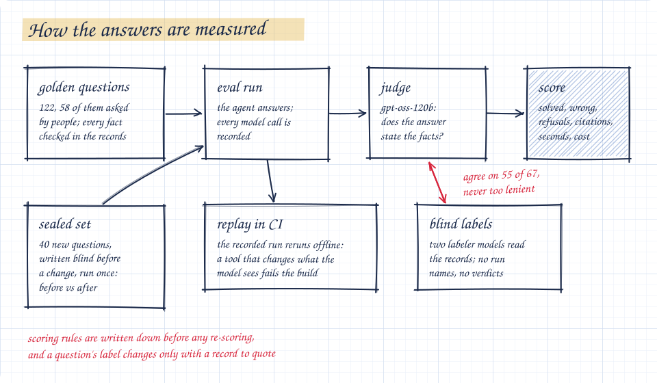
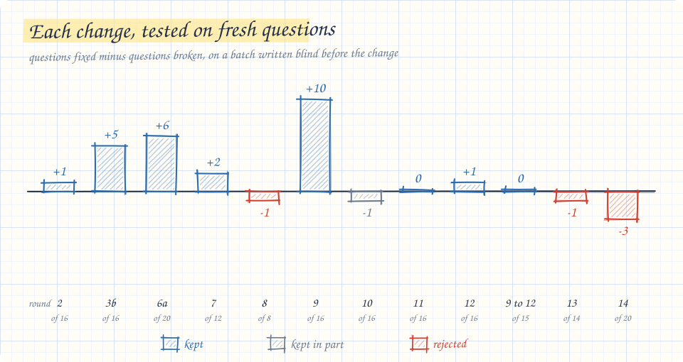
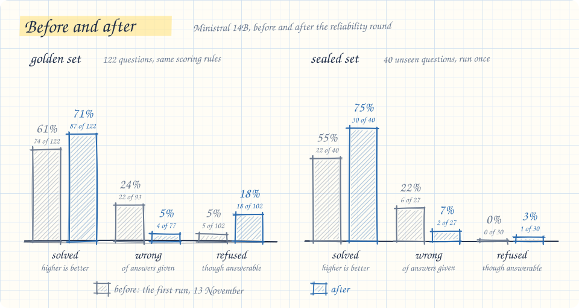
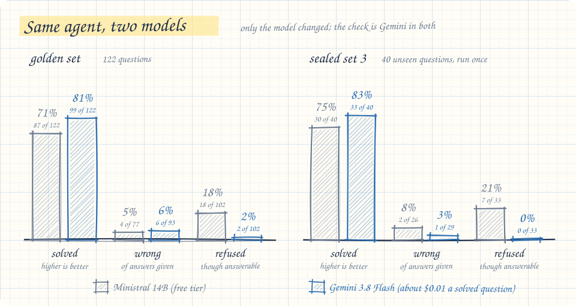
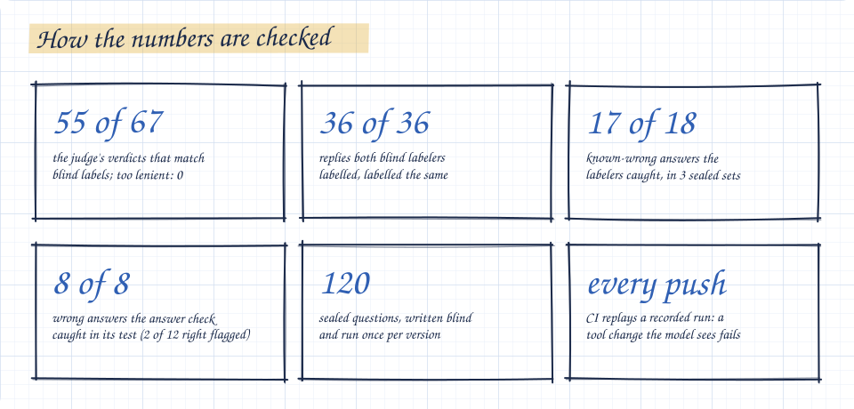
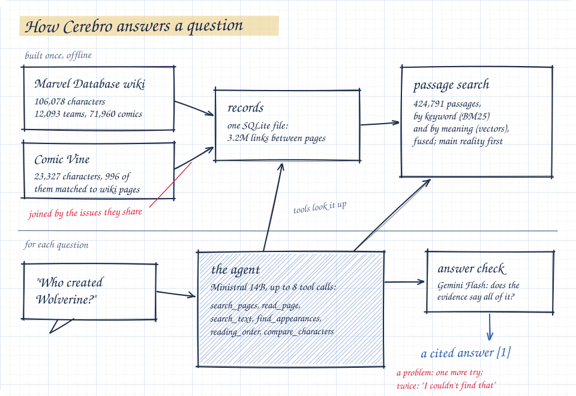
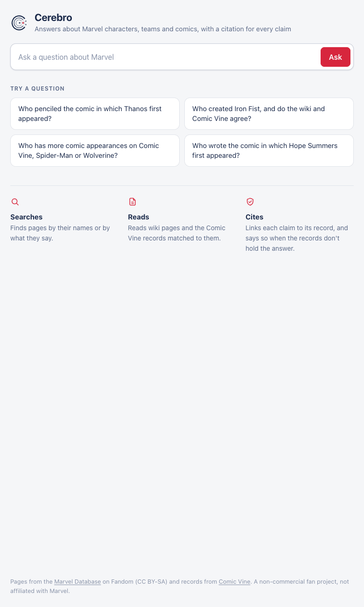

<p align="center">
  <picture>
    <source media="(prefers-color-scheme: dark)" srcset="assets/logo-dark.svg">
    
  </picture>
</p>

# Cerebro

Cerebro is a Marvel research agent and the evaluation harness that measures it. The agent answers questions about Marvel characters, teams and comics from a local copy of the Marvel Database wiki joined to Comic Vine, and cites the record behind every claim. When the records don't hold the answer it says so, and when a name is shared it asks which one you mean.

Most of the work is the harness. 122 questions have every expected fact checked against the records, a judge model is checked against blind labels, sealed question sets are run once, and CI replays a recorded run on every push. Changes to the agent were tested on fresh questions and kept or dropped on their numbers. [RESULTS.md](RESULTS.md) has every run.

## How it's measured

<p align="center">
  <picture>
    <source media="(prefers-color-scheme: dark)" srcset="assets/eval-loop-dark.svg">
    
  </picture>
</p>

- **Questions with checked answers.** 122 golden questions, 58 of them asked by people; each says what a good reply is, and every expected fact was checked against the records. Scoring rules are written down before any re-scoring ([golden-v2-changes.md](evals/golden-v2-changes.md)).
- **A judge that is checked too.** gpt-oss-120b rules on each answer, and its verdicts are compared with blind labels.
- **Fresh questions to test changes.** Rounds of changes were tested on batches written blind before them, and three sealed sets of 40 questions were each run once.
- **Replay.** Every model call is recorded, so a run can be replayed offline, and CI replays one on every push.

[How the evaluation works](docs/evaluation.md) covers each part and where its numbers can mislead.

## What the measurements show

<p align="center">
  <picture>
    <source media="(prefers-color-scheme: dark)" srcset="assets/round-by-round-dark.svg">
    
  </picture>
</p>

Twelve rounds of changes, each tested on its own fresh batch. Rounds 8, 13 and 14 made things worse and were dropped, and round 10 was kept in part.

<p align="center">
  <picture>
    <source media="(prefers-color-scheme: dark)" srcset="assets/before-after-dark.svg">
    
  </picture>
</p>

- **Golden set:** on 122 questions scored by the same rules, two runs of the current code solved 69% and 71%, up from 61% in the first run, and 5% and 9% of their answers were wrong, down from 24%. It refuses more than it did: 15 to 18 questions the records answer, against 5.
- **Sealed set:** on 40 questions written blind and run once, it solved 75%, up from 55%, and gave 2 wrong answers, down from 6 (p = 0.021).
- **Confirmation set:** on 40 more questions, written after the last change and run once on `main`, it solved 85%, and the blind labels found 2 wrong replies.

<p align="center">
  <picture>
    <source media="(prefers-color-scheme: dark)" srcset="assets/two-models-dark.svg">
    
  </picture>
</p>

- **A stronger model:** with Gemini 3.8 Flash in place of Ministral 14B, the same agent solved 81% of the golden set, mostly by refusing less, at about a cent per solved question.
- **Speed and cost:** with Ministral 14B and the check on, an answer takes about 10 seconds and costs about $0.002 on OpenRouter.

<p align="center">
  <picture>
    <source media="(prefers-color-scheme: dark)" srcset="assets/checked-numbers-dark.svg">
    
  </picture>
</p>

[RESULTS.md](RESULTS.md) has the full tables, and the first evaluation, which compared four models.

## How it answers

<p align="center">
  <picture>
    <source media="(prefers-color-scheme: dark)" srcset="assets/answer-flow-dark.svg">
    
  </picture>
</p>

- **Two sources, joined.** The wiki has 106,078 character pages, one for every version of a character: 645 pages are named Wolverine. Comic Vine adds its own counts, powers and creators. Each Comic Vine character is matched to the wiki page whose comics overlap most with its issues ([ADR 1](docs/adr/0001-match-comic-vine-by-shared-issues.md)).
- **Search that knows what a name usually means.** Name search ranks pages by how often the wiki's own links use the name for them, so "Gambit" finds Remy LeBeau first and says so. Passage search fuses keyword and meaning and puts the main reality first ([ADR 2](docs/adr/0002-search-passages-by-keyword-and-meaning.md)).
- **An agent with six tools.** Ministral 14B searches names and passages, reads pages, lists a character's comics by cover date, builds reading orders and compares characters, in at most 8 tool calls. The prompt asks for a citation after every fact, and an answer with none becomes a refusal.
- **A second reader.** Gemini Flash checks each answer against what the tools returned before it is shown ([ADR 3](docs/adr/0003-check-each-answer-with-a-second-model.md)).

Here is one question from an evaluation run of the current code, printed the way `cerebro ask` prints it:

```text
search_pages: Gambit
  MAIN MEANING: the wiki's links mean "Remy LeBeau (Earth-616)" by "Gambit" (99% of them). Read that page unless the question asks for another one.
read_page: Remy LeBeau (Earth-616)
  Remy LeBeau (Earth-616) (character)
find_appearances: Remy LeBeau (Earth-616)
  Remy LeBeau (Earth-616) appears in person in 922 comics' cast lists on the wiki (not Comic Vine's count); the first 20 by cover date:
read_page: X-Men Annual Vol 1 14
  X-Men Annual Vol 1 14 (comic)
check_answer: answers

The editor-in-chief when Gambit first appeared in *X-Men Annual Vol. 1 14* was **Tom DeFalco** [1].

[1] X-Men Annual Vol 1 14: https://marvel.fandom.com/wiki/X-Men_Annual_Vol_1_14

5 model calls, 4 tool calls, 22,012 tokens in, 111 out, 10 s
```

The question was "Who was the editor-in-chief when Gambit first appeared in a comic?" The CLI shows the first line of each tool reply; the model reads all of it.

The chat page shows the same steps as they happen. This is a live recording with Ministral 14B on OpenRouter. The first answer cited Wanda's page, which gives only her own first appearance, so the check sent it back. The agent read Pietro's page, and the second answer passed.

<p align="center">
  <picture>
    <source media="(prefers-color-scheme: dark)" srcset="assets/answer-dark.gif">
    
  </picture>
</p>

## What's in the repo

| Path | What it holds |
| --- | --- |
| `src/cerebro/domain`, `application` | The rules: records, tools, search order, evaluation and scoring. They import no adapter. |
| `src/cerebro/ports`, `adapters` | The interfaces, and their Fandom, Comic Vine, SQLite, model and file implementations. |
| `src/cerebro/bootstrap.py` | The one place adapters are wired to ports. |
| `src/cerebro/interfaces` | The CLI, and the API behind the chat page. |
| `evals/` | The golden questions, and the rules behind golden v2. |
| `docs/` | How the evaluation works, and the design decisions. |
| `tests/` | 552 tests in the default run, including the recorded run CI replays. |
| `web/` | The chat page. |

## Development

Requires [uv](https://docs.astral.sh/uv/).

To see it work without any API keys or data, run `uv sync && uv run pytest`. The tests include a replay of a recorded evaluation: the real tools run over a small wiki, and the saved model replies come back in order.

```sh
uv sync                          # create .venv and install the pinned dependencies
uv run pytest                    # run the tests
uv run pytest -m live            # check API keys against the real services
uv run ruff check                # lint
uv run ruff format               # format
uv run cerebro crawl fandom      # download raw wiki pages; safe to rerun
uv run cerebro crawl comicvine   # download Comic Vine's Marvel characters; safe to rerun (needs COMICVINE_API_KEY)
uv run cerebro parse fandom      # turn them into records in data/records.sqlite
uv run cerebro chunk             # cut the parsed character and comic pages into chunks for search
uv run cerebro embed             # embed every chunk; safe to resume (needs OLLAMA_BASE_URL)
uv run cerebro load comicvine    # store Comic Vine's characters next to them
uv run cerebro match comicvine   # match Comic Vine's characters to the parsed ones
uv run cerebro ask "..."         # answer a question, with citations (needs MISTRAL_API_KEY)
```

With `GEMINI_API_KEY` set, a second model (Gemini Flash) checks each answer against what the tools returned before it is shown. When the check finds a problem, the agent gets one more try; a second problem turns the answer into "I couldn't find that in the records." Without the key, or when Gemini does not reply within 20 seconds, the answer goes out unchecked.

CI runs these checks and replays a recorded evaluation on every push, so a tool that changes what the model sees fails it.

To evaluate a model, answer the golden questions in `evals/golden.jsonl`, judge the answers, then score them. The published results use that set. `evals/golden-v2.jsonl` is the same set with the scoring rules in `evals/golden-v2-changes.md` applied; set `GOLDEN_FILE` to use it. Each run keeps its results in `runs/<run>/`. `eval run --help` lists the models: the `-openrouter` ones need `OPENROUTER_API_KEY`, `ministral-14b` needs `MISTRAL_API_KEY`, and `qwen3-14b-ollama` needs `OLLAMA_BASE_URL`, which also adds vector search to the keyword search.

```sh
uv run cerebro eval run --model ministral-14b-openrouter --run m14   # answer the questions; safe to rerun
uv run cerebro eval judge m14        # have the judge rule on each answer (needs CEREBRAS_API_KEY)
uv run cerebro eval score m14        # write scores.json and report.md
uv run cerebro eval replay m14       # rerun it offline from the saved model exchanges
uv run cerebro eval agreement m14    # check the judge against labels in runs/m14/labels.jsonl
uv run cerebro eval compare m14 m3   # put runs side by side, as Markdown
```

To use the chat page, start the API and then the page, which needs Node 22 (`nvm use` reads it from `web/.nvmrc`):

```sh
uv run cerebro serve             # the question API, on port 8000
cd web && nvm use && npm install && npm run dev
```

Open the address Vite prints. Vite sends `/ask` to the API.

## Data and credits

- Character, team and comic pages, including comic creators and appearances, come from the [Marvel Database](https://marvel.fandom.com) on Fandom, licensed under [CC BY-SA](https://creativecommons.org/licenses/by-sa/3.0/). Text derived from it keeps that license.
- Issue dates and per-character issue lists come from the [Comic Vine API](https://comicvine.gamespot.com/api/) under its terms for non-commercial use. It is not redistributed here. `cerebro crawl comicvine` fetches it with your own API key.

- The evaluation questions in `evals/golden.jsonl` and `evals/golden-v2.jsonl` include questions people asked on [Science Fiction & Fantasy Stack Exchange](https://scifi.stackexchange.com) (CC BY-SA 4.0), in [Natural Questions](https://ai.google.com/research/NaturalQuestions) (CC BY-SA 3.0) and in [WebQuestions](https://nlp.stanford.edu/software/sempre/) (CC BY 4.0). Each line names its source, link and license; questions marked `cerebro` were written for this project.

- The drawings use the [Patrick Hand](https://github.com/google/fonts/tree/main/ofl/patrickhand) font by Patrick Wagesreiter, under the SIL Open Font License ([assets/OFL-PatrickHand.txt](assets/OFL-PatrickHand.txt)).

This is a non-commercial fan project. It is not affiliated with or endorsed by Marvel, Fandom or Comic Vine.

## License

Code is MIT licensed. See [LICENSE](LICENSE).
