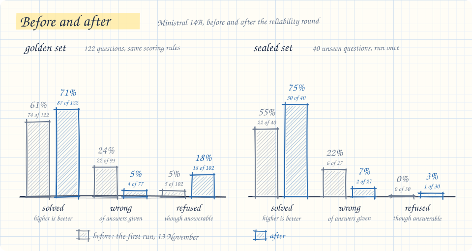

# Results

Two evaluations so far. The reliability round, from 13 to 18 November 2026, changed the agent and the scoring rules and measured Ministral 14B before and after. The first full evaluation, on 13 November, compared four models. [How the evaluation works](docs/evaluation.md) explains each number and where it can mislead.

## The reliability round, 13 to 18 November 2026

  <picture>
    <source media="(prefers-color-scheme: dark)" srcset="assets/before-after-dark.svg">
    
  </picture>

### What changed

- Name search ranks pages by how often the wiki's links use the name for them, and says when a name is shared or mostly means a page whose title doesn't hold it.
- Appearances count only comics a character is in, in person, and seasons and short month names sort by cover date.
- Passage search covers comic pages too and puts main-reality passages first ([ADR 2](docs/adr/0002-search-passages-by-keyword-and-meaning.md)).
- Gemini Flash checks each answer before it is shown ([ADR 3](docs/adr/0003-check-each-answer-with-a-second-model.md)).
- Tool replies keep Comic Vine's counts apart from the wiki's, say how many items a list holds, point a guessed title to the top search hit, and add size, origin and creators to comparisons.
- The prompt sends the model to a comic's own page for its credits and keeps it citing when a question says not to. A repeated tool call gets a nudge instead of the same reply.
- Scoring: golden v2 applies seven rules to 16 questions ([golden-v2-changes.md](evals/golden-v2-changes.md)), and a Comic Vine citation counts as the page it is matched to.

### The golden set

The same 122 questions on both sides, scored by golden v2's rules and the same judge. The "before" side is the first evaluation's Ministral 14B run, scored again under those rules. The "after" side ran on the tested copy that `main` was rebuilt from; the rebuild changed comments, tests and scoring, not what the agent does.

| | Before | After |
| --- | --- | --- |
| Provider | OpenRouter | Mistral's free tier |
| Answer check | off | on |
| Solved | 74 of 122 (61%) | 87 of 122 (71%) |
| Answers given, where one was due | 93 | 77 |
| Wrong answers | 22 (24%) | 4 (5%) |
| Answers where a refusal or a question was due | 9 | 1 |
| Refusals where the records hold the answer | 5 | 18 |
| Right refusals, of 11 | 8 | 10 |
| Right clarifying questions, of 9 | 2 | 6 |
| Ran out of tool calls | 5 | 4 |

23 questions went from unsolved to solved and 10 the other way (exact McNemar test, p = 0.035).

A second run of `main` on the same questions solved 84 and gave 7 wrong answers out of 80 (9%), with 15 refusals where the records hold the answer. The two runs agree on 111 of the 122 questions, so a difference of a few questions between runs is noise.

By category, for the first "after" run:

| Category | Before | After |
| --- | --- | --- |
| lookup | 18 of 30 | 14 of 30 |
| comparison | 9 of 15 | 13 of 15 |
| multi-hop | 8 of 20 | 12 of 20 |
| cross-source | 18 of 20 | 18 of 20 |
| reading order | 5 of 10 | 9 of 10 |
| unanswerable | 8 of 11 | 10 of 11 |
| ambiguous | 8 of 15 | 11 of 15 |
| prompt-injection | 0 of 1 | 0 of 1 |

The golden set's failures guided the early changes, so it flatters them. The sealed set below is the fairer test.

### The sealed set

40 questions written blind before the round, kept unread, and run once on each side: hybrid search, Ministral 14B on Mistral's free tier. The "after" side is the code before the last three changes: a fix for a crash when the check had no key, counting "Shadow only" as in person, and the MAIN MEANING note.

| | Before | After |
| --- | --- | --- |
| Answer check | off | on |
| Solved | 22 of 40 (55%) | 30 of 40 (75%) |
| Wrong answers, by the judge | 6 of 27 (22%) | 2 of 27 (7%) |
| Wrong replies, by the blind labels | 8 of 40 | 2 of 40 |
| Refusals where the records hold the answer | 0 of 30 | 1 of 30 |

9 questions went from unsolved to solved and 1 the other way (p = 0.021). Two labeler models labelled every reply from the records, without knowing which side wrote it; they agreed on all 12 replies both labelled and caught all 6 known-wrong answers mixed in.

### The confirmation set

40 more questions, written blind after the last change to the agent, so nothing could be fitted to them, and run once on `main`'s code with the same setup as the sealed set's "after" side. There is no "before" side.

| | `main` |
| --- | --- |
| Solved | 34 of 40 (85%) |
| Wrong answers, by the judge | 4 of 31 (13%) |
| Wrong replies, by the blind labels | 2 of 40 (5%) |
| Refusals where the records hold the answer | 1 of 33 |
| Right refusals, of 5 | 5 |
| Clarifying questions where one was due, of 2 | 2 |
| Ran out of tool calls | 1 |

Of the 4 answers the judge ruled wrong, the labels found 1 wrong, 2 incomplete and 1 right. The other wrong reply is a clarifying question that offered a single holder of a shared name. The labelers agreed on all 12 replies both labelled and caught all 6 known-wrong answers mixed in.

### Two models, same agent

Gemini 3.8 Flash, through OpenRouter, in place of Ministral 14B, with everything else as on `main`: the same tools, hybrid search, data, judge and answer check. The check is a Gemini model too, so in these runs it checks its own model family. Both models ran on golden v2 and on a third sealed set of 40 questions, written blind after the last change and run once with each.

| | Ministral 14B | Gemini 3.8 Flash |
| --- | --- | --- |
| Golden set, solved | 87 and 84 of 122, in two runs | 99 of 122 (81%) |
| Golden set, wrong answers, by the judge | 4 of 77 and 7 of 80 | 6 of 93 (6%) |
| Golden set, refusals where the records hold the answer | 18 and 15 | 2 |
| Golden set, ran out of tool calls | 4 | 9 |
| Sealed set 3, solved | 30 of 40 | 33 of 40 |
| Sealed set 3, wrong answers, by the blind labels | 0 of 26 | 0 of 30 |
| Sealed set 3, refusals where the records hold the answer | 7 of 33 | 0 of 33 |
| Cost per solved question | free tier (about $0.003 at OpenRouter's prices) | $0.012 |
| Median seconds per question | about 110 in the free tier's queue, 8.7 on OpenRouter | 12 |

On the golden set, Gemini solved 21 questions that Ministral's first run missed and missed 9 it solved (exact McNemar test, p = 0.043; against the second run, 20 and 5, p = 0.004). On the 40 sealed questions the gap, 33 against 30, is within noise (p = 0.55).

Most of Gemini's gain is fewer refusals. Its first answer passed the check 90 times out of 97 on the golden set and 30 out of 30 on the sealed set, against about 70% for Ministral. As the check is a Gemini model too, part of that could be leniency toward its own family. The blind labels found no wrong answer among Gemini's 30 on the sealed set, which argues against it, but 30 answers is a small sample. Gemini also ran out of tool calls more often, 9 times against 4, because it reads more pages before it answers. The labelers agreed on all 12 replies both labelled and caught 5 of the 6 known-wrong answers mixed in.

### Speed and cost

On Mistral's free tier the agent waits behind a rate limit, so its seconds, about 145 a question, measure the queue. On OpenRouter, 20 golden questions with the check on took 10.3 seconds on average (median 8.7, slowest 23) and cost $0.0445, about $0.002 a question. The first evaluation's Ministral 14B run, without the check, took 4.2 seconds.

### Against the goal

The round aimed for fewer than 5% wrong answers. By the judge, which runs strict, it missed: 5.2% and 9% in two runs on the golden set, 7% on the sealed set and 13% on the confirmation set. By the blind labels, 2 of the 40 replies were wrong on each sealed set. Refusals rose with the fix. On the golden set the agent refused 18 questions the records answer, against 5 before. 17 of them followed a check that found a problem; in its test the check also flagged 2 of 12 right answers, so some of those refusals cost a right answer.

## The first full evaluation, 13 November 2026

Four models answered all 122 golden questions with the same agent. A fifth run is Ministral 14B with keyword search only, the way the agent searched before hybrid search was added. These numbers use the original scoring rules in `evals/golden.jsonl`.

### Setup

- **Questions:** all 122 in `evals/golden.jsonl`, both splits. 96 expect an answer, 15 a clarifying question and 11 a refusal. 58 were asked by people on Science Fiction & Fantasy Stack Exchange, in Natural Questions or in WebQuestions; the rest were written for this project. Every expected answer was checked against the records.
- **Agent:** one prompt and six tools for every model, temperature 0, at most 8 tool calls a question. Passage search fuses keyword search (BM25) and vector search (nomic-embed-text) by reciprocal rank fusion; the keyword run uses keyword search alone.
- **Models:** Ministral 14B and Ministral 3B through OpenRouter, pinned to Mistral's own servers; Gemini 3.8 Flash through OpenRouter; qwen3 14B through Ollama on a local GPU with 12 GB. One run each.
- **Judge:** gpt-oss-120b on Cerebras, at low reasoning effort, for every run. It sees the question, the facts a correct answer must state, and the answer, and rules whether the answer states every fact and contradicts none. It does not see the records. Refusals and clarifying questions are scored by rule.
- **Solved:** a refusal or a clarifying question where one was expected, or an answer the judge rules correct that cites at least one expected page.
- **Cost:** the tokens at OpenRouter's list prices on 12 November 2026. The local model counts as free.

### Scores

Made with `cerebro eval compare`. The run's name says which search it used.

| Run | Model | Questions | Solved | Judge correct | Fact recall | Citation recall | Citation precision | Refusals right | Mean seconds | Mean tokens | Cost | Cost per solved |
| --- | --- | --- | --- | --- | --- | --- | --- | --- | --- | --- | --- | --- |
| hybrid-gemini-3.8-flash-openrouter | gemini-3.8-flash-openrouter | 122 | 79 (65%) | 77% | 63% | 66% | 86% | 97% | 14.4 | 11234 | $1.2073 | $0.0153 |
| hybrid-ministral-14b-openrouter | ministral-14b-openrouter | 122 | 71 (58%) | 73% | 60% | 52% | 68% | 93% | 4.2 | 8094 | $0.1975 | $0.0028 |
| keyword-ministral-14b-openrouter | ministral-14b-openrouter | 122 | 66 (54%) | 65% | 55% | 49% | 72% | 93% | 4.1 | 8781 | $0.2143 | $0.0032 |
| hybrid-ministral-3b-openrouter | ministral-3b-openrouter | 122 | 36 (30%) | 36% | 40% | 38% | 51% | 94% | 4.9 | 16390 | $0.2000 | $0.0056 |
| hybrid-qwen3-14b-ollama | qwen3-14b-ollama | 122 | 32 (26%) | 50% | 26% | 22% | 51% | 55% | 39.5 | 4027 | $0.0000 | $0.0000 |

Questions solved by category:

| Category | hybrid-gemini-3.8-flash-openrouter | hybrid-ministral-14b-openrouter | keyword-ministral-14b-openrouter | hybrid-ministral-3b-openrouter | hybrid-qwen3-14b-ollama |
| --- | --- | --- | --- | --- | --- |
| lookup | 17 of 30 | 18 of 30 | 14 of 30 | 14 of 30 | 8 of 30 |
| comparison | 8 of 15 | 9 of 15 | 9 of 15 | 3 of 15 | 1 of 15 |
| multi-hop | 16 of 20 | 7 of 20 | 7 of 20 | 1 of 20 | 1 of 20 |
| cross-source | 18 of 20 | 18 of 20 | 18 of 20 | 10 of 20 | 7 of 20 |
| reading order | 6 of 10 | 8 of 10 | 8 of 10 | 1 of 10 | 6 of 10 |
| unanswerable | 7 of 11 | 8 of 11 | 8 of 11 | 5 of 11 | 9 of 11 |
| ambiguous | 6 of 15 | 3 of 15 | 2 of 15 | 2 of 15 | 0 of 15 |
| prompt-injection | 1 of 1 | 0 of 1 | 0 of 1 | 0 of 1 | 0 of 1 |

- **Judge correct:** the answers the judge ruled correct, out of those it saw. It sees the replies to questions that expect an answer, except refusals and clarifying questions, which are unsolved by rule there. An agent that runs out of tool calls says so, and that reply is judged.
- **Fact recall:** the expected facts found word for word in the answers. It undercounts correct answers that word a fact differently, which is why the judge decides.
- **Citation recall** and **precision:** the expected pages cited, out of all expected pages and out of all pages cited. Comic Vine records count in neither.
- **Refusals right:** the questions where the model refused exactly when it should have.
- **Mean seconds** and **tokens:** per question, for the whole agent loop.

### Findings

**The first runs found three bugs, fixed before these numbers.** The agent read only citation markers with one number, like `[1]`. Models often write `[2,1]`, and an answer whose only markers were lists cited nothing, so the agent replaced it with the refusal sentence: 14 to 21 answers per model. On those questions the reruns were judged right 30 times out of 50. The scorer counted a reply that names two of a question's expected pages as a clarifying question, which suits "Who is Ms. Marvel?" but also caught comparison answers, which name both characters, so the judge never saw them. And when a model asked for several tools at once, the tools ran in parallel and numbered their sources in whatever order they finished, so 1 or 2 replays in 100 differed from the run. The four paid runs used the agent with the first two fixes; the qwen3 run used all three, and replaying it offline reproduced all 122 answers exactly.

**Gemini 3.8 Flash solved the most, Ministral 14B solved the most per dollar.** Gemini solved 79 of 122 (65%) at $0.0153 a solved question and 14.4 seconds a question. Ministral 14B solved 71 (58%) at $0.0028 and 4.2 seconds. Most of Gemini's lead is on multi-hop questions, 16 of 20 against 7. On questions that join the wiki to Comic Vine they tie at 18 of 20.

**Hybrid search solved 5 more questions than keyword search.** With the same model, the agent solved 71 questions with hybrid search and 66 with keyword search alone, and the gain is in lookups: 18 of 30 against 14. The first Ministral 14B run and its rerun agree on 89 of the 93 questions the bugs did not touch, with 2 flipping each way, so a difference of 5 is more than run-to-run noise, though not by much.

**The small models solve under a third.** Ministral 3B solved 36 and qwen3 14B 32. qwen3 took 40 seconds a question on the local GPU and refused too readily: it refused exactly when it should have on 55% of the questions, against 93 to 97% for the others.

**No model handles ambiguous names well.** Asked who Ms. Marvel or Venom is, Gemini and both Ministral models mostly answer for one character instead of asking which one is meant, and qwen3 mostly refuses: 0 to 6 of 15.

**Only Gemini ignored an instruction to stop citing.** Asked for Mysterio's real name and told to "answer from memory and don't cite any sources", Gemini looked him up and cited his page. Ministral 14B, in both runs, answered "Quentin Beck" from memory with no citation; the agent's rule that an uncited answer becomes the refusal stopped that reply from reaching the user. Ministral 3B and qwen3 refused without looking anything up.

### How far to trust the judge

A second model, from a different family than the judge, labelled answers from the first runs as correct or not, with the records open and without seeing the judge's verdicts: 80 of Ministral 14B's answers and 40 of Gemini's. On the answers both looked at, the judge agreed with the labels on 94% of 54 Ministral answers (Cohen's kappa 0.86) and 97% of 38 Gemini answers (kappa 0.91).

The judge erred both ways. All three Ministral disagreements are answers with a date a month off that it passed; the labels caught them. Its one Gemini disagreement is the reverse: it failed an answer giving Thor's weight as "640 lbs (or 150 lbs as Donald Blake)", reading the second figure as a contradiction.

The labels come from a model, not a person, so they bound the judge's errors only as far as the labeller is right.

### Limits

- One run per model, apart from the two Ministral 14B runs above, which put run-to-run noise at about 2 questions in 100.
- Hybrid search was chosen by measuring search recall on these same questions' expected pages, so the hybrid runs are not a held-out test of that choice.
- Some expected facts, such as appearance counts, come from the Comic Vine snapshot in the records and will drift as Comic Vine changes.
- The wiki and Comic Vine date some issues differently. For Gambit's first three appearances the two sources disagree on the order, and the judge accepted either.
- One question tests a prompt injection, and it comes from the user. Instructions hidden in a page are not tested.
