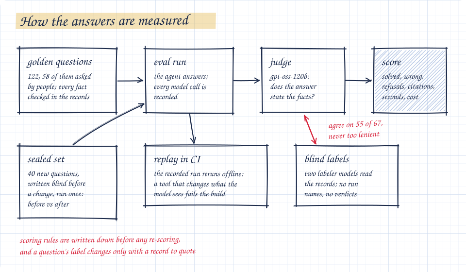

# How Cerebro is evaluated

The agent answers a fixed set of questions whose answers were checked against the records. A judge model, itself checked against blind labels, rules on each answer, and every model call is recorded so a run can be replayed. This page says how each part works and where the numbers can mislead.

<p align="center">
  <picture>
    <source media="(prefers-color-scheme: dark)" srcset="../assets/eval-loop-dark.svg">
    
  </picture>
</p>

## The questions

`evals/golden.jsonl` holds 122 questions. People asked 58 of them, on Science Fiction & Fantasy Stack Exchange (32), in Natural Questions (25) and in WebQuestions (1); the other 64 were written for this project. Each question says what a good reply is:

- the expected outcome: an answer (96), a clarifying question (15), or a refusal (11) when the records can't settle it;
- for an answer, the facts it must state, the pages it should cite and the tools it should need.

Every expected fact was checked against the records, not against memory. The questions cover lookups (30), multi-hop questions (20), questions that need both sources (20), comparisons (15), ambiguous names (15), unanswerable questions (11), reading order (10) and one prompt injection. 80 are in the dev split and 42 in test.

`evals/golden-v2.jsonl` is the same set with seven scoring rules applied, such as what counts as a first appearance and when a shared codename needs a clarifying question. [golden-v2-changes.md](../evals/golden-v2-changes.md) lists each rule and each of the 16 questions it changed, with the record that settles it.

## A run

`cerebro eval run` asks every question with one model and saves, for each question, the tool calls and replies, the answer, and every HTTP exchange: the model's, the embedding server's and the answer check's. A run is safe to stop and start again; it picks up where it stopped.

## The judge

gpt-oss-120b on Cerebras judges each answer. It sees the question, the expected facts and the answer, and rules whether the answer states every fact and contradicts none. It does not see the records. Refusals and clarifying questions are scored by rule, not by the judge.

The judge was checked too. Two labeler models, run apart from the judge and from each other, labelled 67 answers from the records, without run names or the judge's verdicts. The judge agreed with the labels on 55 answers and was too strict on the other 12. It never passed an answer the labels marked wrong, so its count of wrong answers is an upper bound. A new judge prompt has to beat it on fresh labels, not on these 67, so the judge is never tuned to them.

## The scores

`cerebro eval score` writes these for each run:

- **Solved:** a refusal or clarifying question where one was expected or accepted, or an answer the judge rules correct that cites an expected page.
- **Wrong answers:** answers the judge rules wrong, out of the answers given.
- **Citation recall and precision:** expected pages cited, out of all expected pages and out of all pages cited. A Comic Vine record counts as the wiki page it is matched to.
- **Refusals right**, and **fact recall**, the expected facts found word for word.
- **Seconds, tokens and dollars** per question, and dollars per solved question.

`cerebro eval compare` puts runs side by side.

## Testing a change

Before-and-after numbers come from the same questions, scored by the same rules, with these guards:

- The rules a change is scored by are written down before its run, and a question's expected answer changes only with a record to quote.
- A fresh batch of questions is written blind before each change, so the change can't be fitted to them.
- A sealed set of 40 questions, written blind and kept unread, was run once on the code before the reliability round and once near its end.
- Paired results are compared with an exact McNemar test.
- The golden set's failures guided the early changes. After that it became report-only, and no later change was chosen by its score.

## Replay in CI

`tests/fixtures/eval/recorded` is a recorded run of four questions over a small wiki. Every push replays it offline: the real tools run, and the saved model replies come back in order. If a tool's output, a tool description or the prompt changes what the model sees, the replay differs at that step and the build fails. Recording it again costs about a cent:

```sh
CEREBRO_RECORD_EVAL=1 uv run pytest -m live tests/test_recorded_eval.py
```

`cerebro eval replay <run>` does the same for any saved run.

## Where the numbers can mislead

- **One run per setup.** The judge once gave two verdicts on the same answer, so a difference of one or two questions is noise.
- **The sealed set is small.** A 20-point gain on 40 questions is clear (p = 0.021); a 5-point one would not be.
- **Two providers.** The first evaluation ran on OpenRouter and the reliability runs on Mistral's free tier: the same model weights, but behind a rate limit, so their seconds can't be compared.
- **The labels come from models.** They read the records and agreed on all 12 answers both labelled, and caught all 6 wrong answers planted among the rest, but no person checked every label.
- **The judge is strict.** Read its wrong-answer counts as a ceiling.
